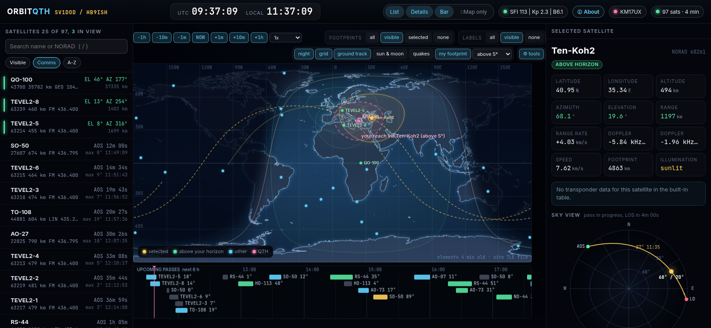

# OrbitQTH

One HTML file that tracks every amateur radio satellite. No server, no
account, no install: download index.html, open it, work the birds.

**Live:** https://hamsat.aganet.gr/

## What it does

- Live world map of all amateur satellites, with day/night terminator and
  coverage footprints
- Pass predictions for your QTH: AOS, LOS, max elevation and duration
- Azimuth, elevation, range and live Doppler with the exact RX frequency
- Uplink, downlink, CTCSS tones and beacons for the workable satellites
- Polar sky view of each pass and a six-hour timeline across all birds
- Works offline: the **tools** menu on the map bar fetches fresh elements,
  loads a TLE file you downloaded yourself, or saves a field-ready copy
  with current elements baked in

## Keeping elements fresh

Positions are computed from orbital element sets (TLEs) that age. The map
shows their age in its bottom-right corner; a set a few days old still points
an antenna fine, weeks old does not.

On the live site, elements refresh automatically. On a downloaded copy,
open the **tools** menu at the right end of the map control bar (the gear
button) and pick what fits:

- **fetch TLEs** downloads current elements over the internet and applies
  them. On a saved copy this pulls straight from CelesTrak, so it needs a
  connection once.
- **load TLE** updates with no connection at all. Download the amateur set
  yourself from
  [CelesTrak](https://celestrak.org/NORAD/elements/gp.php?GROUP=amateur&FORMAT=tle)
  or [AMSAT](https://www.amsat.org/tle/current/nasabare.txt) on any machine,
  carry the file over, press **load TLE** and pick it. The page applies and
  remembers it.
- **offline copy** saves a fresh single file with the current elements baked
  in, ready for the field.

## Quick start

1. Open the live site, or download index.html and open it in any browser.
2. Set your QTH: locator, coordinates, or just click the map.
3. Pick a satellite. The list is sorted by next pass.

MIT license. George Anestopoulos, SV1DOD / HB9ISH.
